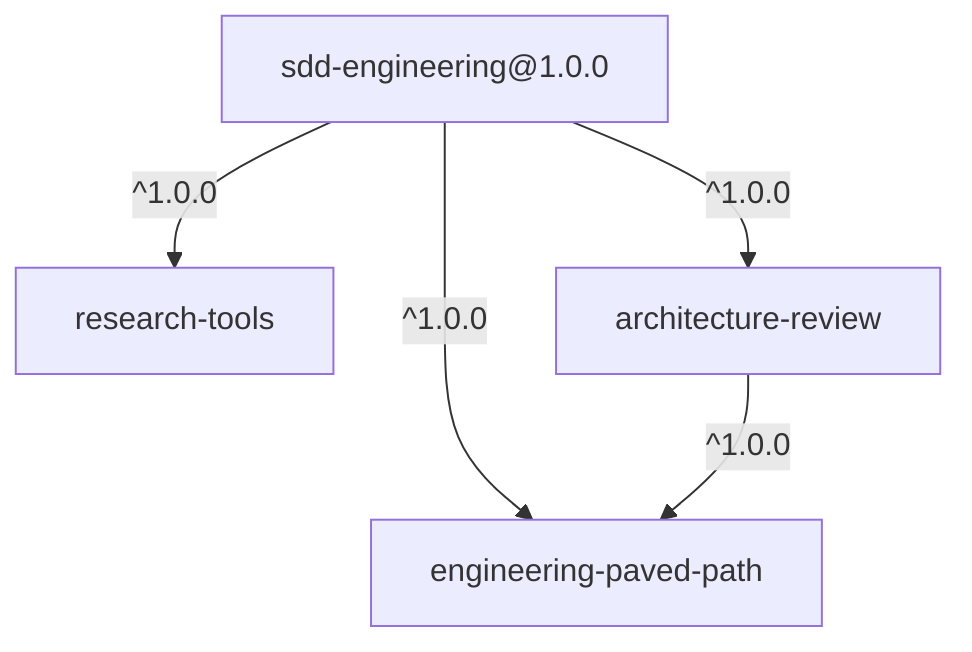

# dev-digest-ai-marketplace

A Claude Code plugin marketplace with the team harness for spec-driven AI
engineering. It is kept separate from any product repository. The product
and the harness have different owners and release cadences: a UI change in
a product never releases a skill, and a skill fix never requires a product
release.

**Catalog:** https://yuramaksymiv.github.io/dev-digest-ai-marketplace/

## Plugins

| Plugin | Version | What it gives you | Depends on |
|---|---|---|---|
| [`engineering-paved-path`](plugins/engineering-paved-path) | 1.0.0 | Shared reference skills: architecture, TypeScript, React, RTL, Next.js, Fastify, Drizzle, PostgreSQL, Zod, security, Mermaid | — |
| [`research-tools`](plugins/research-tools) | 1.0.0 | `researcher`: read-only repository and external research with cited evidence | — |
| [`architecture-review`](plugins/architecture-review) | 1.0.0 | `architecture-reviewer`: independent layering review driven by your repository's own architecture docs | `engineering-paved-path ^1.0.0` |
| [`sdd-engineering`](plugins/sdd-engineering) | 1.0.0 | Spec-Driven Development: `spec-creator` → `implementation-planner` → `/run-plan` (implementer, test-runner, plan-verifier, architecture gate), `engineering-insights`, `workflow-retro` | all three above |



## Install

In Claude Code:

```
/plugin marketplace add YuraMaksymiv/dev-digest-ai-marketplace
/plugin install sdd-engineering@dev-digest-ai-marketplace
```

From a shell, scoped to one project (writes `.claude/settings.json`; commit it):

```bash
claude plugin marketplace add YuraMaksymiv/dev-digest-ai-marketplace --scope project
claude plugin install sdd-engineering@dev-digest-ai-marketplace --scope project
claude plugin list --json
```

Dependencies install automatically. Start a new session or run
`/reload-plugins`.

Update:

```bash
claude plugin marketplace update dev-digest-ai-marketplace
claude plugin update sdd-engineering@dev-digest-ai-marketplace --scope project
```

Roll back to the pinned stable channel: see [docs/RELEASES.md](docs/RELEASES.md#rollback).

## Repository layout

```
.claude-plugin/marketplace.json   latest channel (relative-path plugins)
channels/stable/marketplace.json  stable channel (git-subdir, pinned ref + sha)
plugins/<name>/                   one directory per plugin
docs/                             guidelines, security, releases, site spec, cost baseline
scripts/                          build-index, release, pin-stable, rollback, hygiene
site/                             catalog (React + Vite), deployed to GitHub Pages
.github/workflows/                validate.yml (harness), site.yml (build-site), pages.yml (deploy)
```

## Contributing

Read [CONTRIBUTING.md](CONTRIBUTING.md). Quick check before a PR:

```bash
claude plugin validate .
for p in plugins/*/; do claude plugin validate "$p" --strict; done
bash scripts/check-hygiene.sh
```

| Document | About |
|---|---|
| [CONTRIBUTING.md](CONTRIBUTING.md) | Plugin structure, manifest fields, dependency rules, checks, PR checklist |
| [docs/PLUGIN-GUIDELINES.md](docs/PLUGIN-GUIDELINES.md) | What belongs in a plugin, boundaries, naming, permissions |
| [docs/SECURITY.md](docs/SECURITY.md) | No secrets or absolute paths; what to do after an unsafe release |
| [docs/RELEASES.md](docs/RELEASES.md) | SemVer, tags, channels, update and rollback |
| [docs/SITE-SPEC.md](docs/SITE-SPEC.md) | The GitHub Pages catalog |
| [docs/COST-BASELINE.md](docs/COST-BASELINE.md) | Cost of the SDD scenario and the optimization experiment |
