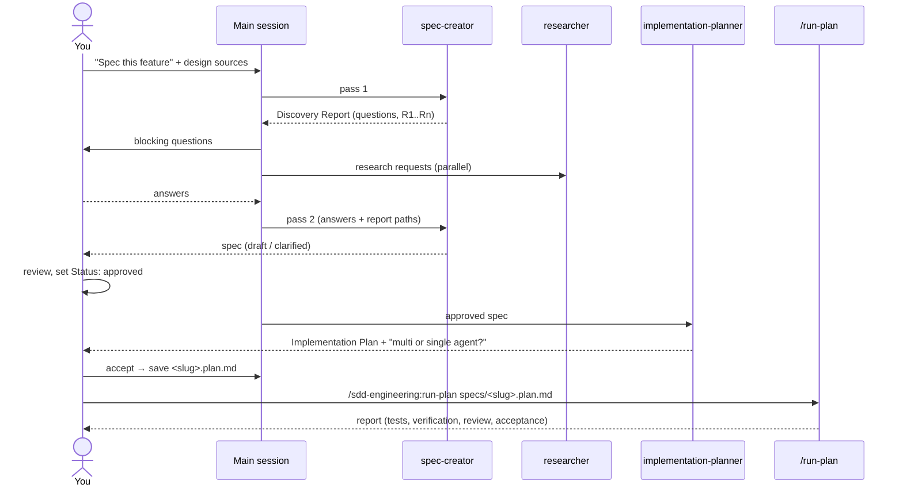

# SDD Engineering

Spec-Driven Development (SDD) workflow for Claude Code. A feature goes
through an explicit chain: **spec → plan → implementation → verification**.
Each step has its own agent, a fixed output format and a pause point where
you decide.

```
/plugin marketplace add YuraMaksymiv/dev-digest-ai-marketplace
/plugin install sdd-engineering@dev-digest-ai-marketplace
```

The installer also installs the three dependencies listed below.

## What's inside

| Component | Kind | Invoke as | What it does |
|---|---|---|---|
| `spec-creator` | agent | `sdd-engineering:spec-creator` | Two passes. Pass 1 returns a Discovery Report (blocking questions, design gaps, research requests) and writes nothing. Pass 2 writes one spec with EARS acceptance criteria (`AC-n`), NFRs, edge cases and traceability. |
| `implementation-planner` | agent | `sdd-engineering:implementation-planner` | Read-only. Turns an **approved** spec into an Implementation Plan: tasks → AC-IDs → skill → test command. Never invents requirements. |
| `implementer` | agent | `sdd-engineering:implementer` | Executes a plan (or one task group), runs scoped tests, ends with an AC-mapped report and a diff digest. Also has a fix mode for reviewer findings. |
| `test-runner` | agent | `sdd-engineering:test-runner` | Runs only documented test commands; returns a compact pass/fail table, never a raw log. |
| `plan-verifier` | agent | `sdd-engineering:plan-verifier` | Read-only traceability gate: `tasks` mode (every T-n is in the code) and `acceptance` mode (every AC is implemented and evidenced). |
| `run-plan` | skill (manual) | `/sdd-engineering:run-plan <plan.md>` | Orchestrates implementer → test-runner → plan-verifier → architecture review with fix rounds → acceptance gate. |
| `engineering-insights` | skill | `/sdd-engineering:engineering-insights` | Reads a module's `INSIGHTS.md` before work and appends substantial new learnings at the end. |
| `workflow-retro` | skill (manual) | `/sdd-engineering:workflow-retro [--deep]` | Retrospective of a finished multi-agent run: tokens, cache hit, cost, duplication, concrete proposals. |

## Dependencies

| Plugin | Range | Used for |
|---|---|---|
| `engineering-paved-path` | `^1.0.0` | Shared skills that the planner assigns and the implementer applies (`engineering-paved-path:architecture`, `:react-best-practices`, `:zod`, …) |
| `research-tools` | `^1.0.0` | `research-tools:researcher` handles the research requests from `spec-creator`'s Discovery Report |
| `architecture-review` | `^1.0.0` | `architecture-review:architecture-reviewer`, the independent review gate inside `run-plan` |

## The flow



1. **Spec.** Ask the main session to "write a spec for …". It runs
   `spec-creator` pass 1, asks you the blocking questions, dispatches
   research to `research-tools:researcher`, then resumes `spec-creator` for
   pass 2. If your request already answers everything, it writes the spec
   in a single pass. You set `Status: approved` yourself. Agents never
   approve.
2. **Plan.** Ask for an implementation plan for the approved spec.
   `implementation-planner` refuses `draft`/`clarified` specs. Once you
   accept the plan, save it next to the spec as `<slug>.plan.md`.
3. **Build.** Run `/sdd-engineering:run-plan <path>/<slug>.plan.md`
   (optionally `--mode multi|single`, `--rounds N`).
4. **Learn.** `/sdd-engineering:engineering-insights` at the end of the
   session. Run `/sdd-engineering:workflow-retro` only when you want a retro.

## Where files go

| Artifact | Path | Written by |
|---|---|---|
| Spec | `<spec folder>/<slug>.md` | `spec-creator` |
| Spec index | `<spec folder>/README.md` (one row per spec) | `spec-creator` |
| Plan | `<spec folder>/<slug>.plan.md` | you / the main session, after you accept the plan |
| Run reports | session scratchpad `run-plan-<slug>/` | `run-plan` |
| Module memory | `<module>/INSIGHTS.md` | `engineering-insights` |
| Retro ledger | `docs/retro/ledger.md` | `workflow-retro` |

`spec-creator` resolves `<spec folder>` in this order:

1. a `spec_dir` passed by the orchestrator;
2. the location your `CLAUDE.md`/`AGENTS.md`/`CONTRIBUTING.md` documents;
3. `<module>/specs/` if the repository already uses per-module specs and
   the feature touches one module;
4. root `specs/`.

To pin the location, add one line to your `CLAUDE.md`, e.g.
`Specs live in docs/specs/.`

## What the workflow expects from your repository

- **Instructions**: a root `CLAUDE.md` or `AGENTS.md` describing modules and
  conventions. The agents read it. They don't assume any layout.
- **Test commands**: documented in instructions, `package.json` scripts,
  a `Makefile` or CI. **If none can be found**, the planner adds an
  "Open questions for the user" item, the implementer and test-runner report
  `skipped — no documented test command`, and `run-plan` asks you once.
  No agent invents a command.
- **Architecture docs** (optional): `ARCHITECTURE.md`, `docs/architecture*`,
  ADRs or a checker config (dependency-cruiser, eslint boundaries). Without
  them the architecture gate applies `engineering-paved-path:architecture`
  defaults and says so.
- Your project instructions always win over the plugin's generic defaults.

## Safety

- Read-only agents (`implementation-planner`, `plan-verifier`, `test-runner`)
  have no Write/Edit tools. `spec-creator` writes only the spec and its
  index row.
- Nothing commits, pushes, switches branches, re-records an architecture
  baseline or edits generated migrations or lock files.
- No credentials or network integrations. Optional project MCP output can
  be passed to `spec-creator` as plain text and is treated as untrusted
  data.

## Evals

`evals/` contains behavior evals for the fixed scenario "prepare a spec and
a plan for a small feature", plus negative cases where SDD must not
activate:

```
claude plugin eval ./plugins --eval-dir sdd-engineering/evals \
  --scaffold --trust-plugin --allow-tools Write Edit --runs 3 --no-publish
```

See [CHANGELOG.md](CHANGELOG.md) and [COMPATIBILITY.md](COMPATIBILITY.md).
